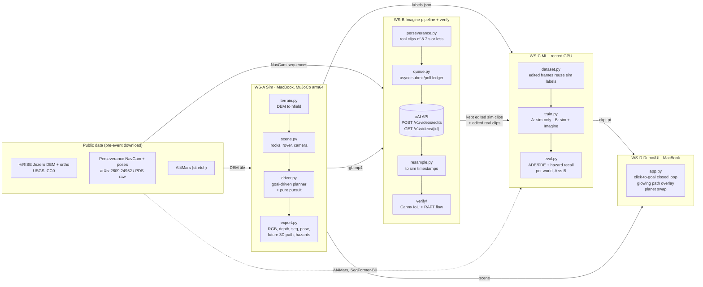

> **Working name:** MarsVQ (subject to change).
> **Pitch:** *"We turn a physics sim into every alien world with Grok Imagine, so rovers can learn to drive anywhere before they land."*
> **Scope:** any alien world. Mars (Jezero crater) is the center of the demo.
> **Team:** one hacker. AI coding agents (Cursor local agents and cloud agents) do the build, and Grok Bot did the planning. Section 10 describes the agent workstreams and the points where the human reviews or integrates.

Status legend: **[KNOWN]** stated in docs or the brief · **[UNKNOWN]** must be measured or confirmed at the event · **[ASSUMPTION]** our choice, can be tuned.

---

## 1. Overview and pitch

Rover autonomy needs driving data from places no rover has been. Sim gives us perfect labels (geometry, path, hazards) but looks wrong. Real data looks right, but there is very little of it and it covers only one world. **MarsVQ uses Grok Imagine as a *transfer* model, the same idea as NVIDIA Cosmos Transfer.** We render a geometry-exact MuJoCo sim of Jezero crater, then restyle each clip with Grok Imagine's **video edit** API into photoreal Mars, Europa ice, Titan haze, a Mars dust storm, a lava world and night. The prompt asks the model to keep camera motion, terrain shape and every rock where they are. Then:

1. A **verification filter** (Canny edge IoU and RAFT optical flow) drops edits whose geometry drifted, so every kept clip still matches its sim labels.
2. We train an **openpilot-style goal-conditioned path network** (camera frame plus goal → 3D trajectory with uncertainty, plus a hazard head). One run uses sim data only and one adds Imagine-edited data.
3. We **stress-test** both models on **real Perseverance NavCam sequences** that we edit into other worlds. Editing changes appearance, not geometry, so the true driven path is still valid ground truth.
4. **Live demo:** click a target in the sim and the policy drives there, with a glowing predicted 3D path over the camera feed. Swap planets.

The headline result is a table of path error (ADE/FDE) and hazard recall for each world, with the sim-only model next to the Imagine-trained model.

---

## 2. Goals / non-goals

**Goals (must)**

- G1: A MuJoCo Jezero sim that exports RGB, depth, segmentation, pose, the goal-conditioned future 3D path and hazard labels, in clips of ≤ 8 s at 480p.
- G2: An async Imagine edit pipeline with ≥ 6 world variants, a resumable job queue, and resampling to sim timestamps.
- G3: A verification filter with per-world thresholds and a kept/rejected report.
- G4: A path net trained twice (sim-only vs. sim + Imagine) under the same budget and augmentation.
- G5: Robustness evaluation on real Perseverance clips edited into ≥ 4 worlds, reporting ADE/FDE and hazard recall.
- G6: A live closed-loop demo on a MacBook, with click-to-goal, the openpilot-style path overlay and a planet switch.
- G7: A Devpost draft by Sat 22:30, then the final Devpost, a video under 3 minutes and the repo by Sun 10:00.

**Stretch**

- S1: Imagine image-to-video as a showcase "world model", scored on action compliance. Showcase only, never used for training.
- S2: A SegFormer-B0 terrain segmenter fine-tuned on AI4Mars as an auxiliary input or head.
- S3: Imagine image gen/edit for planet textures and skyboxes in the live sim, plus per-planet reference consistency.
- S4: A sim + strong photometric augmentation baseline, to separate the Imagine effect from plain color jitter.

**Non-goals**

- Real-time Imagine in the control loop. Latency is minutes per call.
- Wheel–soil physics fidelity (slip and sinkage). Hazards are geometric.
- Flight-qualified autonomy, stereo, or full SLAM.
- Training on any Imagine I2V "world model" output.
- Any claim about Imagine API capabilities beyond those listed in §5.2.

---

## 3. System architecture



**Data flow summary:** sim clip → (labels go straight to training) and (RGB → Imagine edit → resample → verify → kept clips reuse the *same* labels). Real Perseverance clips → Imagine edit → evaluation only.

---

## 4. Components, interfaces and data formats

### 4.1 Conventions [ASSUMPTION, frozen at checkpoint H0]

- **Rover frame:** FLU (x forward, y left, z up), origin at the ground under the rover center. World frame: ENU, local to the DEM tile, in meters.
- **Perseverance poses** come in a **z-down** frame [KNOWN, arXiv 2609.24952 §III]. Convert them to FLU/ENU in `data/perseverance.py`.
- **Video:** H.264 mp4, 854×480, yuv420p, constant `fps_sim` = 15 [ASSUMPTION], duration ≤ 8.0 s (sim) and ≤ 8.7 s (real) [KNOWN input cap: 8.7 s].
- **Waypoints:** 33 points, **indexed by arc length** with s_i = 20·(i/32)² m, i = 0..32 (dense near the rover, 20 m horizon; openpilot-like quadratic spacing) [ASSUMPTION]. We index by distance, not time, because real NavCam frames are captured about once per meter of driving [KNOWN, paper §III], so time-indexed labels would not transfer.
- **Segmentation classes** (aligned to the AI4Mars terrain classes soil, bedrock, sand and big rock): `0 sky, 1 soil, 2 bedrock, 3 sand, 4 rock_small, 5 rock_large, 6 rover_self, 255 ignore`.

### 4.2 Clip folder layout

```text
data/
  sim/<tile_id>/clip_<6d>/
    meta.json            # ClipMeta (schema below)
    rgb.mp4              # 854x480, 15 fps, <= 8.0 s
    depth.npz            # key "depth": float16 [T,H,W], meters along camera z
    seg.npz              # key "seg": uint8 [T,H,W], classes in 4.1
    poses.json           # per-frame world pose (t, xyz, quat_wxyz)
    labels.json          # per-frame Labels (schema below)
    thumbs/000.jpg ...   # 1 fps previews (for human review)
  edited/<tile_id>/clip_<6d>/<world>/
    request.json         # prompt, template id, params sent (secrets stripped)
    job.json             # request id, status history, timestamps, cost estimate
    rgb_raw.mp4          # Imagine output as returned
    rgb.mp4              # resampled to sim timestamps (15 fps, T frames)
    resample.json        # output fps/PTS measured, mapping, duration delta
    verify.json          # metrics + keep/reject
  real/<seq_id>/clip_<6d>/
    meta.json  rgb.mp4  poses.json  labels.json      # same schemas, source="perseverance"
  real_edited/<seq_id>/clip_<6d>/<world>/ ...        # same as edited/
  ledger/jobs.jsonl      # append-only Imagine job ledger (resume/idempotency)
```

### 4.3 `meta.json` (ClipMeta)

```json
{
  "schema_version": "0.2",
  "clip_id": "jz01_000042",
  "source": "sim",
  "tile_id": "jz01",
  "fps": 15,
  "n_frames": 120,
  "duration_s": 8.0,
  "resolution": [854, 480],
  "camera": {
    "model": "pinhole",
    "fx": 427.0, "fy": 427.0, "cx": 427.0, "cy": 240.0,
    "height_m": 1.9, "pitch_deg": -15.0,
    "T_rover_cam": [[0,0,1,0.6],[-1,0,0,0],[0,-1,0,1.9],[0,0,0,1]]
  },
  "goal_world": [143.2, -57.9, 4.1],
  "seed": 1234,
  "driver": {"planner": "astar_slope_rock", "noise": 0.15, "speed_mps": 0.8},
  "terrain": {"dem": "usgs_msr_hirise", "crop_m": [200, 200], "post_m": "UNKNOWN (read from DEM metadata)"},
  "rocks": {"n": 340, "size_dist": "power_law", "seed": 1234},
  "created_utc": "2026-10-17T20:14:03Z",
  "git_sha": "abc1234"
}
```

Camera numbers are placeholders. Match the Perseverance NavCam FOV and mast height from the dataset metadata [UNKNOWN until downloaded].

### 4.4 `labels.json` (per-frame Labels)

```json
{
  "schema_version": "0.2",
  "clip_id": "jz01_000042",
  "waypoint_s_m": [0.0, 0.0195, "...", 20.0],
  "frames": [
    {
      "t": 0.0667,
      "frame_idx": 1,
      "goal_rover": [18.3, -2.1, 0.4],
      "goal_dist_m": 18.4,
      "path_rover": [[0.0, 0.0, 0.0], [0.02, 0.0, 0.0], "... 33 x [x,y,z] ..."],
      "path_valid": [true, true, "... 33 ...", false],
      "hazard_wp": [0, 0, "... 33 ...", 1],
      "hazard_frame": {"rock_large_ahead": 1, "slope_gt_20deg": 0, "sand": 0, "dropoff": 0},
      "speed_mps": 0.79,
      "yaw_rate_rps": 0.05
    }
  ]
}
```

- `path_rover` is the **actually executed** future trajectory, taken from the full episode log. Episodes run past the clip end, so frames near the end still get full 20 m labels. Unreached waypoints are marked `path_valid=false`.
- `hazard_wp[i] = 1` when the swept rover footprint (width 2.7 m [ASSUMPTION], roughly Perseverance) around waypoint i hits a `rock_large` instance taller than 0.3 m, or the local slope is above 20°, or the step height is above 0.25 m. The driver injects about 20% "risky" episodes (noisy or greedy planner) so that hazard positives exist.
- For real clips, `hazard_*` comes from §8.3.

### 4.5 Interface contracts (CLI entry points)

All in one Python package `marsvq`, exposed through `pyproject.toml` `[project.scripts]`. Each command is idempotent and resumable, and writes only inside its own output tree.

| Command | Owner WS | Reads | Writes |
|---|---|---|---|
| `marsvq-sim gen --tile jz01 --n 50 --seed 0 --out data/sim` | A | DEM tile, `configs/sim.yaml` | `data/sim/...` |
| `marsvq-sim view --clip <dir>` | A | clip | window (debug overlay of labels) |
| `marsvq-real build --src <pers_dir> --out data/real --max-s 8.7` | B | Perseverance data | `data/real/...` |
| `marsvq-imagine submit --clips data/sim --worlds mars,europa,titan,dust,lava,night [--dry-run]` | B | clips, `configs/prompts.yaml` | `ledger/jobs.jsonl`, `edited/...request.json` |
| `marsvq-imagine poll --ledger data/ledger/jobs.jsonl` | B | ledger | `rgb_raw.mp4`, `job.json` |
| `marsvq-imagine resample --root data/edited` | B | raw + sim meta | `rgb.mp4`, `resample.json` |
| `marsvq-verify --root data/edited [--calibrate labels.csv]` | B | sim + edited | `verify.json`, `reports/verify.html` |
| `marsvq-train --config configs/train_{A,B}.yaml` | C | data index | `runs/<name>/ckpt.pt`, metrics |
| `marsvq-eval --ckpt ... --split real_edited --out reports/eval.json` | C | ckpt + data | metrics JSON + CSV |
| `marsvq-demo --ckpt ... --world mars` | D | ckpt, sim scene | interactive UI (localhost) |

**Python contracts** (in `marsvq/common/`, owned by the human, frozen at H0, changed only through the human):

- `schema.py`: pydantic models `ClipMeta`, `FrameLabel`, `Labels`, `JobRecord`, `VerifyResult`.
- `io.py`: `load_clip(dir) -> Clip`, `write_clip(clip, dir)`, `read_video(path) -> (frames uint8[T,H,W,3], pts_s float[T])`, `write_video(...)`.
- `geometry.py`: `world_to_rover(pose, pts)`, `project(K, T_rover_cam, pts_rover) -> uv, depth`, `arc_length_resample(path, s)`.
- Model API (C → D): `PathNet.load(ckpt).predict(img_uint8[H,W,3], goal_rover[3]) -> {"paths": [K,33,3], "scale": [K,33,3], "probs": [K], "hazard_wp": [33], "hazard_frame": [4]}`.

### 4.6 Sim (WS-A)

- **Terrain:** crop a 200×200 m Jezero floor tile from the USGS MSR HiRISE DEM and orthoimage (GeoTIFF; read with rasterio). Then detrend, normalize to a MuJoCo `hfield` (`nrow`, `ncol`, `size = [hx, hy, z_range, base]`), and drape the orthoimage as the ground texture. DEM post spacing [UNKNOWN, read from metadata]. Sub-meter detail comes from procedural rocks and noise, not from the DEM.
- **Rocks:** procedural convex meshes (perturbed icospheres, 6 template meshes × random scale and yaw) placed with a power-law size distribution, z-snapped to the heightfield. Each rock gets a unique geom id for segmentation and hazard instance masks.
- **Rover:** **v0 is a kinematic chassis**. A free body is posed each step from the planner, with height and attitude fitted to four wheel-contact raycasts on the hfield. This keeps it robust and lets us skip tuning wheel physics. v1 (stretch) is a 6-wheel differential drive with actuators. The forward camera sits on a mast (see 4.3).
- **Driver:** sample a goal 8–40 m away, run A* on a 0.5 m costmap (slope + rock footprints + margin), and track it with pure pursuit at 0.5–1.0 m/s. Use noise and "risky" modes for hazard positives. Log the full episode at 15 Hz and cut it into clips of ≤ 8 s.
- **Rendering:** `mujoco.Renderer` offscreen at 854×480 with RGB, depth and segmentation (MuJoCo supports depth and segmentation rendering modes). Sim lighting is fixed per tile, so Imagine does the restyling.

### 4.7 Imagine pipeline (WS-B)

**API surface we rely on. These are the only capabilities assumed [KNOWN from brief]:**

| Item | Value |
|---|---|
| Edit endpoint | `POST https://api.x.ai/v1/videos/edits`, model `grok-imagine-video` |
| Input | mp4, ≤ 8.7 s |
| Output | same duration and resolution as input, capped at 720p |
| Mode | async. Poll `GET /v1/videos/{id}` |
| Output fps | **[UNKNOWN]**, undocumented |
| Latency | up to several minutes per edit |
| Rate limit | 10 req/s on video at the lowest tier |
| Price | ≈ $0.06/s at 480p (input $0.01/s + output $0.05/s) |
| Image edit | `POST /v1/images/edits`, up to 5 reference images (optional) |
| Image gen | Imagine image generation for textures and skyboxes (optional) |
| Max concurrent in-flight jobs | **[UNKNOWN]**, probe in hour 1 |
| Exact request field for video input (upload vs. URL), response field names | **[UNKNOWN]**, read the docs at H0 and hard-code nothing else |
| Moderation behavior on prompts or outputs | **[UNKNOWN]** |
| Seed / determinism controls | **[UNKNOWN]**, do not depend on them |

**Queue design:** asyncio with a token bucket (≤ 8 req/s, under the 10 req/s limit) and a configurable `max_inflight` (start at 16, adjust after probing). `jobs.jsonl` is an append-only ledger keyed by `sha1(clip_rgb_bytes + world + template_version)`, which makes jobs idempotent and lets them resume after a crash. Polling uses exponential backoff (5 s → 60 s). On error it retries up to 2× with jitter. Moderation or 4xx errors are logged as `rejected`, not retried. The cost meter sums `duration_s × $0.06` and stops at `budget_usd` from config.

**Resampling (output fps is undocumented):** decode `rgb_raw.mp4` with PyAV to get frames and **PTS**. Let D_out be the output duration and D_sim = n_frames / fps_sim. If |D_out − D_sim| / D_sim ≤ 2%, map each sim timestamp t_k = k / fps_sim to the nearest output frame by PTS. Otherwise rescale linearly (t' = t·D_out/D_sim) and flag it. Write `rgb.mp4` with exactly `n_frames` frames, and record measured fps, frame count and mapping error in `resample.json`. Also measure and log the output resolution [expected: equal to the 480p input].

**Real clips (`marsvq-real build`):** NavCam images are **grayscale stereo pairs taken about once per meter**, with poses at about 8 Hz [KNOWN, paper §III]. We use the left image. A "clip" is a sequence of N consecutive images encoded at a nominal fps so that the duration is ≤ 8.7 s (for example 1 image/m × 8 m ≈ 8 frames at 1 fps, or each image held/cross-faded at 15 fps). The large baseline between frames is a real risk for edit consistency (see §13). Poses are interpolated at each image timestamp.

### 4.8 Verification filter (WS-B), summary (details in §6)

`marsvq-verify` computes per-frame Canny edge IoU and RAFT flow consistency between the sim frames and the resampled edited frames. It applies per-world thresholds and writes `verify.json` plus an HTML contact sheet for human review.

### 4.9 ML (WS-C), summary (details in §7)

PyTorch with MPS on the Mac for dev and inference, and CUDA on the rented GPU for training. `timm` provides the EfficientNet-B0 / ResNet-18 backbone. Training reads clip folders through `dataset.py`. Sim and edited variants of the same clip share labels.

### 4.10 Demo/UI (WS-D)

- **Backend:** Python process that runs MuJoCo, renders the camera, runs `PathNet.predict` on MPS, and has pure pursuit follow the top-1 predicted path. A FastAPI server streams JPEG frames plus JSON state over a websocket.
- **Frontend:** a single HTML/JS page. Left: the camera feed with the **glowing path** (waypoints projected via `geometry.project`, polyline width scaled by 1/depth, additive blur glow, color by hazard probability green → red, uncertainty as a translucent band). Right: a top-down minimap. **Click on the minimap to set the goal.** A planet picker (Mars / Europa / Titan / dust / lava / night) swaps the live sim look (texture, skybox, light, fog), using Imagine-generated textures if S3 lands. A "Imagine replay" tab plays pre-rendered edited clips with the model overlay.
- **Honesty note for judges:** in the live loop the policy sees *sim renders*. Imagine edits are offline (minutes per call), and the edited-video results are shown as replay and as the eval table.

---

## 5. Imagine prompt templates

Prompts live in `configs/prompts.yaml` (versioned, `template_version` is part of the job hash). Structure: **[world appearance] + [lighting/atmosphere] + [invariants]**. The invariant block is identical across worlds.

```yaml
template_version: 3
invariants: >-
  Keep the camera motion, field of view and horizon exactly as in the input.
  Keep the terrain shape and every rock exactly in place, same size and outline.
  Do not add, remove or move any objects. No rover, people, text, or vehicles in frame.
  Photorealistic, natural camera exposure, no stylization.
worlds:
  mars: >-
    Photoreal Mars terrain in Jezero crater: rust-orange regolith and fine dust,
    dark basaltic rocks with dust coating, butterscotch sky, midday sun, sharp shadows.
  europa: >-
    Photoreal Europa surface: fractured bright water ice, bluish-white frost,
    rocks become ice blocks, black starry sky, Jupiter low on the horizon, harsh low sun.
  titan: >-
    Photoreal Titan surface: dim orange haze, low contrast, damp dark sand and
    rounded water-ice pebbles, diffuse light, thick atmosphere, soft shadows.
  dust: >-
    Photoreal Mars during a regional dust storm: suspended orange dust, reduced
    visibility with distance, muted shadows, wind-blown dust near the ground.
  lava: >-
    Photoreal young volcanic world: black basalt and glassy rock, faint glowing
    cracks far in the background only, dark sky with volcanic haze.
  night: >-
    Photoreal Mars at night lit only by the rover's forward headlights:
    falloff with distance, deep shadows behind rocks, dark sky with stars.
```

Rules:

- One edit per (clip, world). Do not run prompt chains on the same clip.
- **Pilot first:** 3 clips × 6 worlds at H1. Measure geometry metrics, then lock `template_version`.
- Keep prompts neutral to limit moderation risk. Words like "glowing cracks" go into the pilot, and we watch for rejections [UNKNOWN].
- **Optional per-planet consistency (S3):** use `/v1/images/edits` with up to 5 reference images to produce one "hero" restyled still per world, kept as a visual reference for prompt tuning and for live-sim textures. Imagine image gen can produce tileable ground textures and skyboxes for the demo sim. Whether reference images can condition *video* edits is **[UNKNOWN]** and not assumed.

---

## 6. Verification filter details

**Goal:** keep only edited clips whose geometry still matches the sim labels.

Per clip, on the resampled frames (sim frame S_k, edited frame E_k):

1. **Canny edge IoU (tolerant).** Convert to grayscale, apply a 5×5 Gaussian blur, then run Canny with auto thresholds (median-based, σ = 0.33). Compute IoU between dilate(edges(S_k), r = 3 px) and dilate(edges(E_k), r = 3 px). Also compute **rock-boundary recall**: the fraction of `rock_large` instance-mask boundary pixels (from `seg.npz`) that have an edited-frame edge within 3 px. Rock boundaries carry the hazard labels, so this is the metric that matters most.
2. **Optical flow consistency (RAFT).** Use `torchvision.models.optical_flow.raft_small` (pretrained weights) on consecutive pairs (k, k+1) for both sequences, at 480p or downscaled to 432×240. Report median EPE between the sim flow and the edited flow, masked to non-sky pixels. Flow catches temporal drift (rocks sliding, camera-motion changes) that per-frame edges miss. If RAFT on MPS is slow or unsupported [UNKNOWN], run it on CPU or the GPU box, or fall back to OpenCV Farneback.
3. **Global checks:** frame count after resampling equals `n_frames`; duration delta ≤ 5%; no black or frozen frames (frame-diff variance).

**Decision** (per world, since dust and night legitimately lose edges):

```text
keep = (median_edge_iou >= tau_e[world]) and (p10_rock_recall >= tau_r[world])
       and (median_flow_epe <= tau_f) and global_checks_ok
```

Initial thresholds [ASSUMPTION]: τ_e = 0.30 (mars/europa/titan/lava), 0.20 (dust/night); τ_r = 0.6; τ_f = 1.5 px at 432×240. **Calibrate at H2:** the human grades about 20 clips (good/bad) from the contact sheet, and thresholds are set for ≥ 90% precision on "good". Report the keep rate per world in the Devpost.

**Frame-level fallback:** if a clip fails only in its tail (drift late in the clip), keep the frames before the first failing frame, provided that leaves at least 3 s.

---

## 7. Model and training details

### 7.1 Architecture: `PathNet` (openpilot-style, goal-conditioned)

- **Input:** a single RGB frame resized to 224×384 (crop the top 10% sky band) plus `goal_rover` (x, y, z, dist, sin/cos bearing) → MLP(64). Single frame is the default because real NavCam frames are about 1 m apart, so a temporal stack would not transfer. A 2-frame variant is a stretch.
- **Backbone:** EfficientNet-B0 (timm, ImageNet-pretrained) → final feature map → global pool (1280-d). ResNet-18 is a fallback.
- **Fusion:** concatenate [img 1280, goal 64] → MLP 512 → 512, with FiLM of the goal on the last backbone stage as an option.
- **Heads:**
  - **Path (MHP):** K = 5 hypotheses × 33 waypoints × 3 (x, y, z) means plus 33×3 Laplace log-scales, and K mode logits.
  - **Hazard:** 33 per-waypoint logits (`hazard_wp`) plus 4 frame-level logits (`hazard_frame`).
  - **Optional (S2):** a SegFormer-B0 fine-tuned on AI4Mars produces a 4-class terrain map, pooled to an 8×16 grid and concatenated as extra features.
- **Size / speed:** about 6 M params. Inference on M5 Pro MPS is estimated at under 15 ms [UNKNOWN, measure].

### 7.2 Losses

- Path: winner-takes-all Laplace NLL on the hypothesis with the lowest L2 to the ground truth (valid waypoints only), plus cross-entropy on the mode logits toward the winner. Weight the 3D z axis at 0.5.
- Hazard: BCE with `pos_weight` computed from the training set's positive rate (frame head plus waypoint head).
- Total: L = L_path + 0.5·L_mode + 1.0·L_haz.

### 7.3 Data and runs

| | Run A: sim-only (baseline) | Run B: sim + Imagine |
|---|---|---|
| Train frames | sim RGB of all train clips | same sim frames **+** verified edited variants (same labels) |
| Mixing | n/a | 30% sim / 70% edited, uniform across worlds [ASSUMPTION] |
| Augmentation | identical: random crop/scale ±10%, brightness/contrast ±20%, random grayscale p = 0.3 (real NavCam is grayscale), horizontal flip with y-mirrored labels | identical |
| Budget | same number of optimizer steps | same |
| Optim | AdamW lr 3e-4, wd 1e-4, cosine, batch 128, bf16 (A100/H100) | same |

- **Splits:** by DEM sub-tile (spatial holdout). `jz01` train/val and `jz02` sim-test. Never split by frame.
- **Frame sampling:** every 3rd frame (5 Hz) to cut redundancy. 50 clips × 120 frames / 3 ≈ 2k sim frames, or about 10k+ with edits. Generate more *sim-only* episodes (cheap) when time allows. Run B still uses only the edited subset.
- **Compute:** about 1.5–2 h per run on one A100/H100, run in parallel or one after the other. Use the Mac (MPS) only for overfit and smoke tests.
- **S4 control (stretch):** Run A′ = sim + strong photometric/color augmentation, to show that the Imagine gain is more than color jitter.

---

## 8. Evaluation plan and metrics

### 8.1 Test sets

1. **Sim-test (jz02):** sim RGB plus verified edited variants per world (held-out tile).
2. **Real-original:** Perseverance NavCam clips, unedited (grayscale, replicated to 3 channels).
3. **Real-edited:** the same clips edited into **Europa, Titan, dust storm and night** (plus Mars-color if budget allows). Edits change appearance only, so the **true driven path stays valid**. The same verification filter (edges and flow against the original real clip) gates which edits count.

### 8.2 Metrics (per world × model A/B)

- **ADE / FDE (m):** top-1 (highest-probability mode) mean and final L2 over valid waypoints. Also report minADE@5. Break down into lateral and longitudinal errors.
- **Hazard recall** at the operating threshold set on sim-val for 90% precision, plus **AUROC** and AP.
- **Robustness gap:** Δ = metric(world) − metric(real-original), per model. The pitch claim is that B has a smaller gap than A.
- **Closed-loop (sim, demo worlds):** success rate (reach the goal within 1.5 m), collision rate with `rock_large`, and mean path tracking error over 20 scripted goals per world.
- **Uncertainty:** NLL and calibration (fraction of ground-truth waypoints inside the predicted 1σ band).
- Use bootstrap 95% CIs over clips. With about 10 real source clips, **call results indicative, not conclusive**.

### 8.3 Real-data labels

- **Path:** future poses from the dataset → FLU of the current frame → arc-length resampling at s_i. The goal is the pose at the end of that drive segment (or 20 m ahead when the segment is longer).
- **Hazard** [ASSUMPTION; the dataset has no geometric hazard labels]: a waypoint is positive if the measured slip > dataset p90 or tilt > 15° along the driven footprint (following the paper's slip-p90 definition). The driven path by design avoided big rocks, so positives will be rare. Optionally hand-label `rock_large_ahead` on about 100 frames (30 min of human time) for frame-level recall.
- **Fallback dataset** (if the arXiv 2609.24952 download is not live): public Mars 2020 raw NavCam images (PDS / mars.nasa.gov raw image archive). Pose availability and fields in raw-image metadata are **[UNKNOWN]**. If poses are missing, estimate relative poses with ORB + essential-matrix VO (scale from the ~1 m spacing assumption) and mark the path metrics "approx-GT".

### 8.4 Stretch: action compliance (S1)

Use Imagine image-to-video with the current frame plus a text action ("rover turns left 15 degrees"), and `last_frame` pinned to a restyled sim render (per the brief; verify in the docs). Measure the yaw between the first and last frames with ORB + essential-matrix VO. Report the **MAE of |θ_prompt − θ_VO|** over θ ∈ {−30, −15, 0, +15, +30}° × 2 worlds (10 calls). Showcase only. Latency is minutes per step and I2V pricing is **[UNKNOWN]**.

---

## 9. Demo script (target 2:45, recorded)

| # | Time | Shot | Voice-over (gist) |
|---|---|---|---|
| 1 | 0:00–0:12 | Black → real Perseverance NavCam frame of Jezero, cross-fade to the same frame as Europa ice | "Rovers only get one world of training data. We give them every world." |
| 2 | 0:12–0:30 | MuJoCo sim of the Jezero DEM: RGB / depth / seg / path labels in a 4-up grid | "A physics sim of real HiRISE terrain gives perfect labels: geometry, path, hazards." |
| 3 | 0:30–0:55 | Same 8 s clip, 6-up: sim → Mars, Europa, Titan, dust, lava, night (Grok Imagine video edit) | "Grok Imagine edits the look and keeps every rock in place." |
| 4 | 0:55–1:10 | Verification view: edge overlays (sim vs. edit), flow arrows, kept/rejected badges, keep-rate per world | "We verify geometry with edge IoU and optical flow, so labels stay true." |
| 5 | 1:10–1:25 | Architecture diagram (from §3), 5 s, then the PathNet heads | "An openpilot-style network: frame plus goal in, 3D path and hazards out." |
| 6 | 1:25–2:05 | **Live demo:** click a target on the minimap, the rover drives, glowing path over the camera, hazard turns red near a boulder, path bends. Switch planet ×2. | "Click anywhere and it drives. Same policy, any world." |
| 7 | 2:05–2:30 | Results table plus bar chart: ADE/FDE and hazard recall per world, A vs. B, on **real Perseverance clips edited into other worlds** | "On real Mars data edited into Europa, Titan, dust and night, the Imagine-trained model holds up while the baseline doesn't." *(Say only what the numbers show.)* |
| 8 | 2:30–2:40 | (If S1 landed) I2V "turn left 15°" clip with measured angle | "Imagine as a world model: we measure whether it obeys." |
| 9 | 2:40–2:45 | Title card: name, Grok Imagine + Cursor + Grok Bot logos/text, repo URL | "Learn to drive anywhere before you land." |

Production: screen-capture the UI at 1080p and keep a scripted cursor path for shot 6. Record narration separately. Show a ≤ 1 s "built with Cursor" agent-panel clip in shot 5 or 9 for the SpaceXAI track.

---

## 10. Workstreams, agent briefs and timeline (solo + agents)

### 10.1 Operating model

- **The human (hacker)** owns `marsvq/common/` (contracts), `configs/`, git integration, all spend decisions, threshold calibration, the Devpost and the video. The human is the only one who merges to `main`.
- **Agents:** four parallel workstreams, each on its own branch `ws/<name>`, touching only its own package directory plus tests. Mac-bound work (MuJoCo rendering, demo UI, MPS) runs as **Cursor local agents** on the MacBook. Pure-code work (Imagine client, verify, training code) can also run as **Cursor cloud agents**. **Grok Bot** handled planning (this spec) and can be used to review progress against the checklists. All of this goes in the Devpost for the SpaceXAI track, so **lean into Cursor usage and keep evidence** (agent run history, screenshots).
- **Integration rhythm:** each workstream lands small PRs that pass its acceptance tests. The human merges at checkpoints H0–H7. Contract changes need human approval, and the human then broadcasts them to every agent.
- **Stubs first:** every workstream starts against `tests/fixtures/fake_clip/` (a generated 2 s clip with valid schema). Nobody waits on anybody.

### 10.2 Suggested repo layout

```text
marsvq/                       # repo root (created after 12:30 Sat; first commit = timestamp evidence)
  README.md                   # quickstart, results table, demo gif, attribution of data/weights
  pyproject.toml              # deps + [project.scripts] CLI entry points
  configs/
    sim.yaml  prompts.yaml  verify.yaml  train_A.yaml  train_B.yaml  demo.yaml
  marsvq/
    common/   schema.py  io.py  geometry.py  config.py          # HUMAN-OWNED contracts
    sim/      terrain.py  rocks.py  scene.py  rover.py  driver.py  render.py  export.py  cli.py   # WS-A
    imagine/  client.py  queue.py  ledger.py  prompts.py  resample.py  cli.py                     # WS-B
    verify/   edges.py  flow.py  filter.py  report.py  cli.py                                     # WS-B
    data/     dataset.py  perseverance.py  splits.py                                              # WS-C (+B for perseverance)
    model/    pathnet.py  losses.py  train.py  eval.py  export.py                                 # WS-C
    demo/     server.py  loop.py  overlay.py  static/index.html  static/app.js                    # WS-D
  scripts/    gpu_bootstrap.sh  sync_data.sh  make_contact_sheet.py
  tests/
    fixtures/fake_clip/       # tiny valid clip (generated by a test helper, not hand-made)
    test_schema.py  test_sim.py  test_imagine.py  test_verify.py  test_model.py  test_demo.py
  reports/                    # eval.json, verify.html, figures (gitignored except final figs)
  data/                       # gitignored; large data never committed
```

### 10.3 Agent task briefs

Each brief can be pasted as-is into a Cursor agent. Shared preamble for all agents:

> *You are working in repo `marsvq`. Read `MarsVQ_spec.md` §4 (contracts) first. Only modify files under your workstream directory and `tests/test_<ws>.py`. Use `marsvq.common.schema/io/geometry` and never redefine schemas. Do not vendor or clone external repos; use pip dependencies only. All code must be newly written. Commit small and often with clear messages. Finish when the acceptance tests below pass, then write a short `ws_<name>_NOTES.md` covering open issues.*

#### WS-A: Sim (Cursor local agent, MacBook)

- **Goal:** `marsvq-sim gen` produces valid clip folders (§4.2–4.4) from the Jezero DEM.
- **Inputs:** `data/raw/usgs_dem/*.tif`, `data/raw/usgs_ortho/*.tif`, `configs/sim.yaml`.
- **Tasks:**
  1. `terrain.py`: crop, detrend and normalize the DEM to an hfield, and write the ortho texture PNG. Expose `height_at(x, y)` and `slope_at(x, y)`.
  2. `rocks.py`: procedural rock meshes and power-law placement. Return instances (id, center, radius, height).
  3. `scene.py`/`rover.py`: generate MJCF (hfield, rocks, kinematic rover body, mast camera with intrinsics from config). Implement four-point attitude fitting.
  4. `driver.py`: costmap, A*, pure pursuit, goal sampling, risky mode.
  5. `render.py`/`export.py`: offscreen RGB/depth/seg at 854×480, 15 fps. Compute future-path labels by arc length and hazard labels (§4.4). Write mp4 + npz + json.
  6. `cli.py`: `gen` (multiprocess, one process per CPU core) and `view` (draws projected labels on frames).
- **Acceptance tests:**
  - `pytest tests/test_sim.py`: the schema validates; `n_frames == fps·duration`; depth > 0 on ground pixels; seg contains classes {1, 5}; `path_rover[0] ≈ 0`; projecting `path_rover` of frame k lands on ground pixels (seg ≠ sky) for ≥ 95% of valid waypoints; hazard positive rate is between 5% and 40%.
  - Throughput ≥ 1 clip per 20 s per core on the M5 Pro.
  - `marsvq-sim view` on 3 clips shows labels aligned with the imagery (**human visual check at H1**).

#### WS-B: Imagine pipeline + verification (Cursor cloud agent for code; runs on the Mac)

- **Goal:** turn clip folders into resampled, verified edited clips at controlled cost, and build the real Perseverance clips.
- **Inputs:** `data/sim`, `data/raw/perseverance/`, `configs/prompts.yaml`, `configs/verify.yaml`, `XAI_API_KEY` from env (never logged or committed).
- **Tasks:**
  1. `client.py`: a thin wrapper over `POST /v1/videos/edits` and `GET /v1/videos/{id}`. Field names come **only** from the official docs (human confirms at H0). Download the output to `rgb_raw.mp4`.
  2. `queue.py`/`ledger.py`: token bucket ≤ 8 req/s, `max_inflight` config, append-only `jobs.jsonl`, idempotent hashing, resume, backoff, budget cap, `--dry-run` (prints cost and requests without sending).
  3. `resample.py`: PTS-based mapping per §4.7. Log measured fps and resolution.
  4. `verify/`: Canny IoU, rock-boundary recall, RAFT-small flow EPE, global checks, per-world thresholds, `--calibrate` from a human CSV, and an HTML contact sheet (sim | edit | edge overlay, 4 frames per clip).
  5. `data/perseverance.py` + `marsvq-real build`: load sequences, convert z-down → FLU, cut into clips ≤ 8.7 s, encode mp4, write labels (§8.3). Include the PDS fallback loader.
- **Acceptance tests:**
  - `pytest tests/test_imagine.py` with a **mocked HTTP server**: submit → poll → download; ledger resumes after a kill with no duplicate submits; budget cap stops submission; 429/5xx back off; 4xx/moderation is marked `rejected`.
  - Resample unit tests: a synthetic 24 fps video of the same duration maps to exactly T frames with ≤ ½-frame error; a duration mismatch gets flagged.
  - Verify unit tests: an identical video → IoU ≈ 1 and EPE ≈ 0; a video shifted by 20 px → rejected; a color-only change (hue rotate) → kept.
  - Live smoke test (human-triggered at H0+): 1 real edit end to end, with latency, fps, resolution and cost logged.

#### WS-C: ML (Cursor cloud agent for code; training on rented GPU)

- **Goal:** train runs A and B, and produce `eval.json` per world plus the `PathNet.predict` API for the demo.
- **Inputs:** clip folders (sim, edited with `verify.keep == true`, real, real_edited), `configs/train_*.yaml`.
- **Tasks:**
  1. `dataset.py`: index clips, sample frames, pair each edited frame with its sim labels, apply augmentations (with label mirroring), and support the world-mix ratio.
  2. `pathnet.py`/`losses.py`: §7.1–7.2. `predict()` API per §4.5.
  3. `train.py`: AMP, checkpoints every N steps, metrics in JSONL (with optional wandb), deterministic seeds, resume.
  4. `eval.py`: ADE/FDE (top-1, min-of-5), hazard recall@P90/AUROC/AP, per-world tables, bootstrap CIs, CSV + markdown table + bar chart PNG.
  5. `scripts/gpu_bootstrap.sh`: set up the env on RunPod/Vultr/Modal and sync `data/` (rsync, or tar of the train subset).
  6. (S2) SegFormer-B0 fine-tune on AI4Mars and feature hookup.
- **Acceptance tests:**
  - `pytest tests/test_model.py`: forward shapes; loss decreases on fake data; mirrored-augmentation label consistency; `predict()` runs on CPU and MPS.
  - **Overfit test:** 1 clip, 300 steps → ADE < 0.2 m on that clip.
  - Run A val ADE beats a constant-curvature "drive straight to goal" baseline (also implemented in `eval.py`).
  - `eval.py` produces the full world × model table with no NaNs.

#### WS-D: Demo/UI (Cursor local agent, MacBook)

- **Goal:** a closed-loop interactive demo per §4.10 that looks great on video.
- **Inputs:** sim scene from WS-A (`scene.py` API), checkpoint from WS-C (or `--mock-policy` until then), `configs/demo.yaml`.
- **Tasks:**
  1. `loop.py`: sim step → render → policy → pure pursuit → step at ≥ 10 Hz. Mock policy = A* path from the WS-A driver.
  2. `overlay.py`: project waypoints and draw the glowing polyline (multi-pass blur, additive), uncertainty band, hazard color ramp, goal marker.
  3. `server.py` + `static/`: websocket stream, minimap with click-to-goal (pixel → world via tile transform), planet picker, HUD (speed, distance to goal, hazard prob, fps), and an Imagine replay tab that plays `edited/.../rgb.mp4` with offline-computed predictions.
  4. Planet looks: per-world sky color, fog, light, ground texture swap (use Imagine-generated textures from `assets/worlds/<world>/` if present).
- **Acceptance tests:**
  - `pytest tests/test_demo.py`: projecting a known 3D point matches the expected pixel; minimap click → world → minimap round-trip error < 0.5 m.
  - Manual: 10 clicks on Mars reach the goal ≥ 8/10 with the mock policy, and the UI holds ≥ 10 fps at 854×480 on the M5 Pro.
  - Screen recording of 30 s without stutter (**human check at H5**).

### 10.4 Human checkpoints

| ID | When (Sat/Sun PT) | Human does |
|---|---|---|
| H0 | Sat 12:30–13:15 | Create repo, write `common/` contracts + fixtures + `pyproject.toml`, confirm Imagine request fields from the docs, launch 4 agents with briefs, fire **1 Imagine smoke edit** on a Perseverance clip (measures latency, fps, resolution, geometry). |
| H1 | Sat ~15:30 | Review the first 3 sim clips (`view`) and the 3×6 pilot edits. Lock `prompts.yaml` template_version and approve the mass submit budget. |
| H2 | Sat ~19:00 | Grade ~20 edits from the contact sheet and run `--calibrate`. Freeze thresholds. Approve Run A launch. |
| H3 | Sat 22:00–22:30 | **Devpost draft submitted** (name, members + Discord, tracks: AI/creative tech + SpaceXAI, early screenshots). |
| H4 | Sun ~01:00 | Run A done, Run B launched. Sanity-check eval on real-original. Merge demo with the real checkpoint. |
| H5 | Sun ~04:00 | Eval table A vs. B across all worlds. Choose demo worlds. Review demo recording. |
| H6 | Sun 07:00–09:00 | Record and edit the video (≤ 3:00), update the README results, final Devpost text. |
| H7 | Sun ≤ 09:30 | **Final submission** (target 30 min before the 10:00 deadline): repo link, video, tracks. Judging 10:30 in the HUB Ballroom. |

### 10.5 Timeline (Sat 12:30 → Sun 10:00, ≈ 21.5 h)

| Window (PT) | WS-A Sim | WS-B Imagine/Verify | WS-C ML | WS-D Demo/UI | Human |
|---|---|---|---|---|---|
| Sat 12:30–13:30 | scaffold terrain + hfield | client + mocked tests; **smoke edit on a real clip** | dataset on fixtures | overlay + projection on fixtures | **H0** |
| 13:30–15:30 | rocks, rover, camera, export; first 3 clips | queue/ledger, resample; `real build` | PathNet + losses + overfit test | server + UI skeleton, mock policy | integrate, unblock |
| 15:30–16:00 | | pilot 3×6 edits | | | **H1** |
| 16:00–19:00 | driver + labels; **mass-gen 50+ clips** (more sim-only after) | **mass submit** (≈ 300 sim edits + ≈ 40 real) as clips land; verify + contact sheet | GPU bootstrap; Run A dry run on sim | click-to-goal, minimap, HUD | monitor spend |
| 19:00–19:30 | | | | | **H2** |
| 19:30–22:30 | sim-test tile jz02; demo scene hooks | drain queue, retries, verify all; real-edited set ready | **Run A** training; eval harness | planet looks; Imagine texture assets (S3) | **H3 Devpost draft by 22:30** |
| 22:30–01:00 | bugfix; (v1 wheeled rover, stretch) | (S1 I2V calls, stretch) | Run A eval; **Run B** start | integrate real ckpt | **H4** |
| 01:00–04:00 | support demo | (S1 compliance metric) | Run B; full eval table; figures | closed-loop metrics per world; polish | **H5** at ~04:00 |
| 04:00–07:00 | — | — | (S4 control run if budget) | replay tab | **sleep ~3 h** while agents/training finish |
| 07:00–09:00 | — | — | final numbers frozen | demo recording takes | **H6** video + Devpost |
| 09:00–10:00 | — | — | — | — | **H7** submit ≤ 09:30, buffer |

The critical path is sim clips → Imagine latency → verify → Run B → eval. Start the Imagine queue as soon as the first sim clips exist (~15:30) and keep it saturated.

---

## 11. Pre-event checklist (before Sat 12:30, no code)

Confirm with organizers that pre-downloading public data and weights and writing planning docs beforehand is allowed.

- **Accounts:** xAI API key with credits (≥ $200 headroom) and the tier's video rate limit confirmed; RunPod / MLH Vultr ($100 code) / Modal ($30) account active with a GPU template chosen; Devpost account, team page and Discord handle ready; Cursor (agent and cloud agents enabled); GitHub.
- **Installs (Mac, arm64):** Python 3.11+, `mujoco`, `torch` (MPS), `torchvision`, `timm`, `transformers` (SegFormer), `opencv-python`, `av`, `ffmpeg`, `rasterio`, `numpy`, `pydantic`, `fastapi`, `uvicorn`, `pytest`, OBS or another screen recorder. Verify `mujoco.Renderer` works headless on macOS.
- **Downloads:**
  - USGS MSR HiRISE DEM + orthoimage (CC0): <https://www.usgs.gov/data/mars-sample-return-hirise-mosaics-terrain-relative-navigation> (DOI 10.5066/P13CPYYU). Note the post spacing and CRS.
  - AI4Mars: <https://data.nasa.gov/dataset/ai4mars-a-dataset-for-terrain-aware-autonomous-driving-on-mars>
  - Perseverance M2020 driving dataset (arXiv 2609.24952). **Download link unconfirmed** ("will be available"). Fallback: Mars 2020 raw NavCam images (PDS / mars.nasa.gov raw image archive). Pre-pick ~10 drive sequences of ≥ 8 consecutive images.
  - Pretrained weights cached: timm `efficientnet_b0`, `resnet18`; torchvision `raft_small`; HF `nvidia/mit-b0` / SegFormer-B0.
- **Planning (allowed docs, not code):** this spec, prompt drafts (text), demo script, Devpost outline.
- **Do NOT before 12:30:** create the repo or write code, call Imagine, or train anything.

---

## 12. Budget

Imagine edit cost per second at 480p ≈ $0.06 (input $0.01/s + output $0.05/s). An 8 s sim clip costs ≈ $0.48 per world; an 8.7 s real clip ≈ $0.52.

| Item | Low | High | Notes |
|---|---|---|---|
| Sim edits | 25 clips × 6 worlds = 150 × 8 s × $0.06 = **$72** | 50 clips × 6 worlds = 300 × 8 s = **$144** | one edit per (clip, world) |
| Real edits | 10 seq × 4 worlds = 40 × 8 s = **$19** | 40 × 8.7 s = **$21** | Europa, Titan, dust, night |
| **Imagine subtotal** | **≈ $91** | **≈ $165** | matches the ~$90–170 estimate |
| Retry/reject contingency (+20%) | $18 | $33 | moderation and drift rejects |
| Pilot + smoke tests | ~$9 | ~$9 | 3×6 + 1 |
| Imagine image gen/edit (S3) | ? | ? | **price [UNKNOWN]**, cap at $10 |
| Imagine I2V (S1) | ? | ? | **price [UNKNOWN]**, ≤ 10 calls, cap at $10 |
| GPU (A100/H100 @ $1.2–2.9/h, 3–6 h) | $4 | $17 | likely covered by Vultr $100 / Modal $30 credits |
| **Total cash ceiling** | **≈ $125** | **≈ $245** | set `budget_usd: 200` in config, human approves at H1 |

Rate limit: 10 req/s is not the bottleneck. **Latency (minutes) × max in-flight jobs [UNKNOWN] is.** Example: if in-flight jobs are capped at 10 and each takes 4 min, then 340 edits take about 2.3 h. That is why submission starts at H1 and runs continuously.

---

## 13. Risks and mitigations

| Risk | Impact | Mitigation |
|---|---|---|
| **Geometry drift** (rocks moved, added or removed; terrain reshaped) | labels invalid, Run B poisoned | Strong invariant prompt block; pilot before mass submit; verification filter with rock-boundary recall; frame-level truncation; per-world thresholds calibrated by the human. If keep rate < 30% for a world, drop that world from training (keep it in eval). |
| **Unknown output fps** | misaligned labels | PTS-based resampling to sim timestamps; duration check; flow verifies temporal alignment; log measured fps in `resample.json`. |
| **Latency (minutes per edit)** | data arrives late, Run B slips | Smoke edit at H0; submit from ~15:30 continuously; train Run B on whatever is verified by ~23:00; Run A never waits on Imagine. |
| **Rate limits / unknown concurrency** | throughput collapse | Token bucket under 10 req/s; probe `max_inflight` at H0; backoff on 429; ledger resume. |
| **Moderation rejections** | missing worlds | Neutral wording; pilot every world; swap phrasing (e.g. "lava" → "dark volcanic basalt"); log `rejected` and do not loop. |
| **Dataset availability** (arXiv 2609.24952 link unconfirmed) | no real-world eval | Pre-event check; fallback PDS raw NavCam; VO-estimated poses marked approx-GT; worst case, eval on the jz02 sim-test plus the real-original qualitative demo only. |
| **Real NavCam sparsity** (≈ 1 image/m, grayscale) | Imagine temporal consistency unknown on slideshow-like clips | Single-frame model; distance-indexed waypoints; test both encodings (1 fps vs. held frames at 15 fps) in the H0 smoke test; verify per frame against the original. |
| **Sim-to-real camera mismatch** (FOV, height, grayscale) | inflated real error for both models | Match NavCam intrinsics/height from dataset metadata; random-grayscale aug for both runs; report the *gap* A vs. B, not absolute numbers. |
| **Imagine gain = plain color aug?** | weak claim | S4 control run A′ if time allows; otherwise state it as a limitation. |
| **MuJoCo rover dynamics rabbit hole** | sim late | Kinematic chassis v0; wheeled rover is a stretch only. |
| **RAFT on MPS** slow or unsupported | verify bottleneck | Downscale to 432×240; CPU/GPU-box fallback; Farneback fallback. |
| **70% rule / originality** | disqualification | No cloned repos or vendored code; pip libraries only; repo created after 12:30 with frequent commits; README credits data, weights and libraries; no pre-written code. |
| **Agent integration conflicts** | broken main | Strict directory ownership; human-owned contracts; fixtures; merge only at checkpoints with tests green. |
| **Solo fatigue** | bad decisions at 4 AM | Scheduled 3 h sleep while training runs; final numbers frozen at 07:00; submission target 09:30. |
| **Budget overrun** | cash | `budget_usd` hard cap in the queue; `--dry-run` cost preview; human approval at H1. |

---

## 14. Rules compliance checklist (DubHacks '26)

- [ ] No coding, building, Imagine generation or training before **Sat 12:30 PM**. Accounts, installs and public data/weights pre-download **confirmed with organizers**.
- [ ] Repo created after 12:30. Git history shows incremental work. **≥ 70% of code written during the event**: no cloned repos, no vendored code, pip dependencies only.
- [ ] All code written during the event by the hacker with Cursor agents. Agent usage is evidenced (Cursor history/screenshots) for the SpaceXAI track.
- [ ] **Devpost draft by Sat 10:30 PM** with all members and Discord handles, and tracks declared.
- [ ] Tracks: exactly **one title track = Chef's Choice: AI/creative tech** + **SpaceXAI** sponsored side track (≤ 3 side tracks allowed).
- [ ] SpaceXAI: built with **Cursor** (heavy use, documented); **Grok Imagine API** is central (video edit; image gen/edit optional); **Grok Bot used for planning** is noted in the Devpost.
- [ ] **Final submission by Sun 10:00 AM** with the code repo linked and a **recorded video (< 3 min)**.
- [ ] Present at judging, **Sun 10:30 AM, HUB Ballroom**.
- [ ] Data licenses credited in the README: USGS (CC0), AI4Mars and Perseverance data per their terms, pretrained weights per their licenses.

**Judging alignment (title track):** Functionality 30% (live closed loop + real-data eval) · Track applicability 30% (generative AI as a data engine, central to the result) · Design 20% (openpilot-style glowing path UI, planet switch, clean video) · Creativity 20% (Imagine-as-Cosmos-Transfer for alien worlds, plus the action-compliance world-model test).

---

## 15. Open questions

1. Exact request schema for `/v1/videos/edits`: is the video uploaded or passed by URL, and what are the field names? Can we pass a seed or strength? **[UNKNOWN, docs at H0]**
2. Output fps and codec of edited videos, and whether output resolution exactly equals the 480p input. **[UNKNOWN, measure]**
3. Max concurrent in-flight video jobs per account and tier, beyond 10 req/s. **[UNKNOWN]**
4. Moderation policy on planetary/"lava"/"night" prompts. **[UNKNOWN]**
5. Does Imagine keep geometry on large-baseline, slideshow-like real NavCam clips? Does it colorize grayscale input? **[UNKNOWN, smoke test]**
6. Prices for image gen/edit and image-to-video; does I2V support `last_frame` as described? **[verify]**
7. Perseverance dataset release link and format (poses, timestamps, camera models). Do PDS raw images include usable pose metadata? **[UNKNOWN]**
8. HiRISE DEM post spacing and vertical accuracy for the chosen tile. **[read metadata]**
9. Organizer rulings: is pre-downloading data/weights OK, is a pre-written spec/prompt text OK, and how is the 70% code rule measured with AI agents?
10. Final project name (MarsVQ is a placeholder).

---

## 16. Sources

- Brief-provided Grok Imagine API facts (endpoints, limits, pricing): xAI API docs, <https://docs.x.ai>. Confirm the exact pages at H0.
- USGS, *Mars Sample Return HiRISE Mosaics for Terrain Relative Navigation* (2025), CC0, DOI 10.5066/P13CPYYU: <https://www.usgs.gov/data/mars-sample-return-hirise-mosaics-terrain-relative-navigation>
- AI4Mars dataset (NASA): <https://data.nasa.gov/dataset/ai4mars-a-dataset-for-terrain-aware-autonomous-driving-on-mars>
- Chiu et al., *Learning to Drive on Mars: Visual Multimodal Traversability Estimation for Off-World Navigation*, arXiv 2609.24952: <https://arxiv.org/abs/2609.24952> (500 sols, 45 km, ~43k grayscale stereo NavCam pairs at ~1 m spacing, poses ~8 Hz, z-down; dataset "will be available").
- Mars 2020 raw images (fallback): <https://mars.nasa.gov/mars2020/multimedia/raw-images/> · PDS Imaging Node: <https://pds-imaging.jpl.nasa.gov/>
- NVIDIA Cosmos Transfer (inspiration): <https://github.com/nvidia-cosmos/cosmos-transfer1>
- openpilot (path-prediction UI and MHP inspiration): <https://github.com/commaai/openpilot>
- MuJoCo docs: <https://mujoco.readthedocs.io>
- RAFT (Teed & Deng, 2020): <https://arxiv.org/abs/2003.12039> · SegFormer (Xie et al., 2021): <https://arxiv.org/abs/2105.15203> · EfficientNet (Tan & Le, 2019): <https://arxiv.org/abs/1905.11946>
- DubHacks: <https://dubhacks.co>
